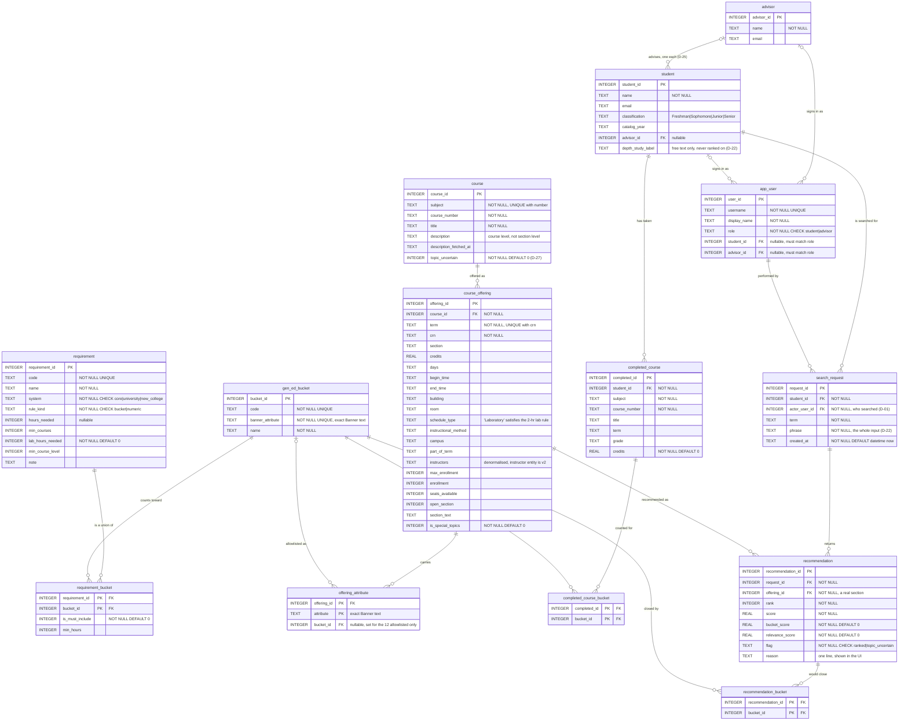

# Data model

Fourteen tables, generated from [`schema.sql`](../schema.sql) and verified against the live
database on 2026-11-03: `schema.sql` was rebuilt into a scratch database and every column diffed
against `navigator.db`. All 14 tables present, every column identical on name, type and not-null.

The presentation version of this model, with the current-state and future-state process diagrams
beside it, is the `process and data model (v2).html` deliverable in the project vault. This file
is the repository's copy — it renders on GitHub and it diffs against the schema.

## Entity relationships

## The groups

| Group | Tables | Rows loaded |
|---|---|---|
| People and access | `advisor`, `student`, `app_user` | 1 / 3 / 4 (seeded) |
| Requirements | `gen_ed_bucket`, `requirement`, `requirement_bucket` | 12 / 13 / 13 |
| Catalog | `course`, `course_offering`, `offering_attribute` | 3,324 / 9,621 / 7,414 |
| Student record | `completed_course`, `completed_course_bucket` | 72 / 48 (seeded) |
| Search and results | `search_request`, `recommendation`, `recommendation_bucket` | demo traffic |

SQLite, `PRAGMA foreign_keys = ON`, 17 foreign keys, 6 indexes, no views and no triggers. No
foreign key declares `ON DELETE`, so every one restricts by default — nothing cascades, and a
parent row cannot be deleted while children reference it.

`gen_ed_bucket` is the hub: four tables resolve to it, which is what makes a bucket the shared
vocabulary between what a student has done, what a course offers, and what a requirement wants.

## The three load-bearing decisions

**Requirements are a union of buckets, not a hierarchy (D-28).** A `requirement` joins to many
`gen_ed_bucket` rows through `requirement_bucket`. Measured on the term's own data, nesting would
be wrong: Literature co-tags Humanities 95% of the time and World Language 93%, but Fine Arts
only 10% and History / Social-and-Behavioral **0%**. Modelling Literature as a child of Humanities
would silently drop the 5% that are not, and the checklist's "including at least one Literature"
clause would have nowhere to live. It is carried as `requirement_bucket.is_must_include`.

**Lab is not an attribute.** No Banner attribute anywhere contains "lab". The 2-hour lab rule
inside the 8-hour Natural Science requirement is satisfied from
`course_offering.schedule_type = 'Laboratory'` (296 sections), so `requirement.lab_hours_needed`
carries it as its own column rather than as a bucket.

**`recommendation.offering_id` is NOT NULL.** Every recommendation points at a real offered
section. This resolves a conflict between ERD v1 and the process diagram in favour of the ERD,
which is also what D-16 requires: a recommendation that is not a real offered section is not
representable, so the grounding guarantee holds at the schema level rather than only in code.

## A correctness trap the schema cannot prevent

A course can carry two buckets belonging to the **same** requirement — SPA 101 is both World
Language and Humanities — so a naive `SUM` over the join counts its credits twice and overstates
progress. `db.outstanding_buckets` sums over `DISTINCT completed_id`. Getting this wrong marks a
requirement satisfied and hides a course the student still needs, which is exactly the failure
the product exists to prevent (F-12, NFR8).

## Cut from ERD v1

`topic`, `course_topic`, `career`, `career_topic`, `search_request.career_id` — a hard-coded
taxonomy, which D-22 forbids. Replaced by `course.description` ranked against a typed phrase.

## Not in the model yet

Specified in the PRD, absent from the schema. Full list in
[`Architecture.md`](Architecture.md) §7.

| What | Needs | Status |
|---|---|---|
| Rule provenance — source document, revision date, catalog year | A `rule_source` table, or columns on `requirement` | Proposed D-29 / D-32, **not accepted** |
| Seminar themes per NEW course | An `nc_seminar_theme` table plus a `NC_SEMINAR` requirement with theme-coverage and level-distribution rules | Proposed D-31, **not accepted** |
| A proposed term an advisor checks in one pass | No table for a proposed term | FR30, a Must in the SOW |
| Depth-study candidates awaiting advisor confirmation | A proposal record with an advisor decision | FR31; must never assert (F-04) |

The seminar-theme work is the largest, because it adds a requirement *kind* the schema does not
have: coverage across three themes plus a level distribution, rather than hours against a bucket
pool.
